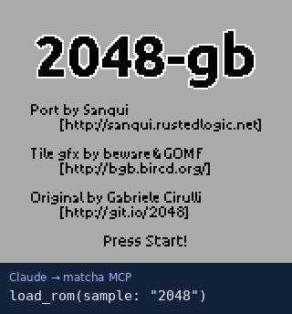
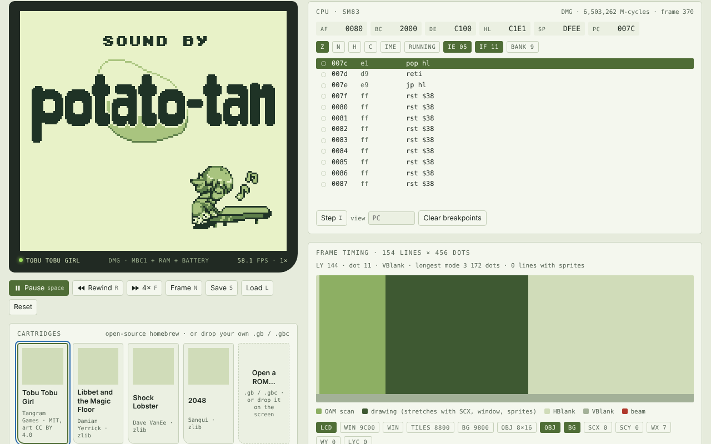

# Matcha

A Game Boy and Game Boy Color emulator you can see inside — and that
Claude can play.

**[Play in your browser](https://play.whago.net/)** · [Download](#download) · [Use it from Claude](#use-it-from-claude)





One portable Rust core (`no_std`, zero dependencies, no `unsafe`) with three
hosts:

- **Web player** — a single offline HTML file: sound, keyboard/touch/gamepad,
  battery saves, save states, 20 seconds of rewind, and a live debugger
  (CPU, disassembly, per-line PPU timing, VRAM, audio channels, RAM search).
  Four open-source homebrew games are on the shelf.
- **Claude plugin** — an MCP server with 17 tools (`load_rom`, `press`,
  `screenshot`, `breakpoint`, `find_value`, …) and three skills, so Claude
  can play, test and debug Game Boy software. Node only; no npm packages.
- **`matcha` CLI** — headless runs and screenshots, the conformance
  scoreboard, a profiler, an instruction tracer and a disassembler.

And a study: every Homebrew Hub cartridge an original Game Boy can run —
868 of them — played for a minute by Matcha and by SameBoy side by side
([`docs/analysis.md`](docs/analysis.md)). The comparison found three Matcha
bugs, since fixed. The [new automatic DMG/CGB study](docs/cgb-analysis.md)
revalidates all 1,235 supported-mapper cartridges from the same pinned corpus.

## Accuracy

Generated by `matcha test` — full list in [`docs/CONFORMANCE.md`](docs/CONFORMANCE.md).

| Suite | Passed |
|---|---|
| SingleStepTests SM83 (every opcode, every bus cycle) | 498,000 / 498,000 |
| Mooneye (DMG-applicable acceptance + emulator-only) | 94 / 94 |
| dmg-acid2 | 1 / 1 |
| Blargg (cpu, timing, sound, OAM bug) | 43 / 43 |
| Gambatte (DMG hex-result and screenshot tests) | 1,642 / 1,783 |
| Mealybug Tearoom (mid-scanline effects) | 9 / 24 |

The pixel FIFO now applies palette, scroll and window changes during a
scanline. Native Game Boy Color adds banked memory, RGB palettes, double-speed
CPU operation and VRAM DMA. Both cgb-acid2 and cgb-acid-hell match their
reference images exactly. The separate [CGB scoreboard](docs/CONFORMANCE-CGB.md)
records the remaining timing failures and excluded compatibility-mode tests.
DMG-on-CGB colourization and precise hardware quirks remain; see
[`ROADMAP.md`](ROADMAP.md).

## Reproduce a homebrew debugging session

With Node 18 or newer, run `node mcp/debug-homebrew.mjs`. No package install,
ROM download or credentials are needed. The script creates a small original
program, identifies the instruction writing `$42` to `$C000`, steps to the next
write, and proves that save/restore replays it exactly. It also verifies rejected
requests preserve the machine, save slots, breakpoints, search and palette.
See [the manual MCP walkthrough](docs/MCP-HOMEBREW.md) for the tool calls and
known limits. This is debugger workflow evidence, not a hardware accuracy score.

## Download

From the [latest release](https://github.com/rad1092/matcha/releases/latest):

- `matcha.html`: the web player as one offline file. Open it in any browser.
- `matcha.plugin`: the Claude plugin, a ZIP with the MCP server inside. Node 18 or newer.
- `matcha-<platform>`: the command-line tool for macOS, Windows and Linux
  (from 0.1.2; earlier releases need a Rust build).
- `SHA256SUMS`: run `shasum -a 256 -c SHA256SUMS` after downloading.

Bundled homebrew notices are in the plugin and `HOMEBREW-LICENSES.md`. Only use
ROMs you are allowed to run.

## Use it from Claude

Install `matcha.plugin` in the Claude desktop app. For any other MCP client,
unzip it and add this server, with the real absolute path:

```json
{"mcpServers":{"matcha":{"command":"node","args":["/absolute/path/matcha-plugin/server/server.mjs"]}}}
```

Then ask Claude to load one of the bundled games and play, or to find where a
game keeps your lives. Save slots live in the MCP process and are lost when it
exits.

## Quick start

```sh
# Play: open the bundled page (after building it once, see below)
open dist/matcha.html

# Claude plugin: install dist/matcha.plugin in the Claude desktop app

# CLI
cargo build --release
target/release/matcha run game.gb --seconds 10 --screenshot shot.png
target/release/matcha run color.gbc --model auto --screenshot color.png
target/release/matcha trace game.gb --input monkey --last 50
target/release/matcha run game.gb --ram noise   # power on with junk in RAM, as hardware does
target/release/matcha disasm game.gb --addr 0150

# Tests
scripts/fetch-testdata.sh                 # test ROMs + SingleStepTests (not committed)
cargo test --workspace                    # unit tests + 498k CPU cases
target/release/matcha test testdata/roms --baseline docs/conformance.json
target/release/matcha test testdata/roms --model cgb --baseline docs/conformance-cgb.json

# Builds
scripts/build-wasm.sh                     # core -> web/matcha.wasm
node scripts/build-web.mjs                # dist/matcha.html
scripts/build-plugin.sh                   # dist/matcha.plugin
```

The web player, JavaScript wrapper, CLI and MCP choose CGB for colour-capable
cartridges by default; `--model dmg` / `--model cgb` or the corresponding
`model` option overrides this. The Rust `GameBoy::new` API remains DMG; use
`GameBoy::new_with_model` for explicit native CGB.

Keys in the web player: arrows, X = A, Z = B, Enter = Start, Backspace =
Select; Space pause, R rewind (hold), F fast-forward, N next frame, I step,
S/L save/load state, M sound.

Save-state format is now version 4. Older quick-save snapshots cannot be
loaded; cartridge battery saves keep their existing format.

## How it's built

| | |
|---|---|
| [`docs/ARCHITECTURE.md`](docs/ARCHITECTURE.md) | System design: timing model, components, data flow, interfaces, performance |
| [`docs/adr/`](docs/adr/) | Ten decision records (timing, PPU, portability, WASM ABI, audio, save states, MCP, verification, pixel FIFO, native CGB) |
| [`docs/analysis.md`](docs/analysis.md) | The homebrew corpus study and the SameBoy comparison |
| [`CONTRIBUTING.md`](CONTRIBUTING.md) | Rules and commands for anyone changing the code |
| [`docs/STATUS.md`](docs/STATUS.md) | Current state and how to pick the work up |

```
crates/matcha-core   the emulator (CPU, PPU, APU, timer, cartridges, save states, debugger, profiler)
crates/matcha-cli    matcha: run, test, profile, trace, disasm, info
crates/matcha-wasm   C-ABI WebAssembly exports
web/                 JS wrapper, player source, bundled homebrew
mcp/                 MCP server + end-to-end test
plugin/              Claude plugin (skills, manifest)
analysis/            corpus study pipeline (manifest, profiling, SameBoy reference, report)
```


## License

MIT or Apache-2.0, at your option. The bundled homebrew ROMs keep their own
licences ([`web/roms/LICENSES.md`](web/roms/LICENSES.md)).
